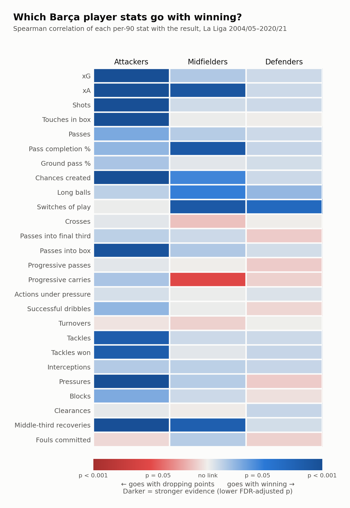
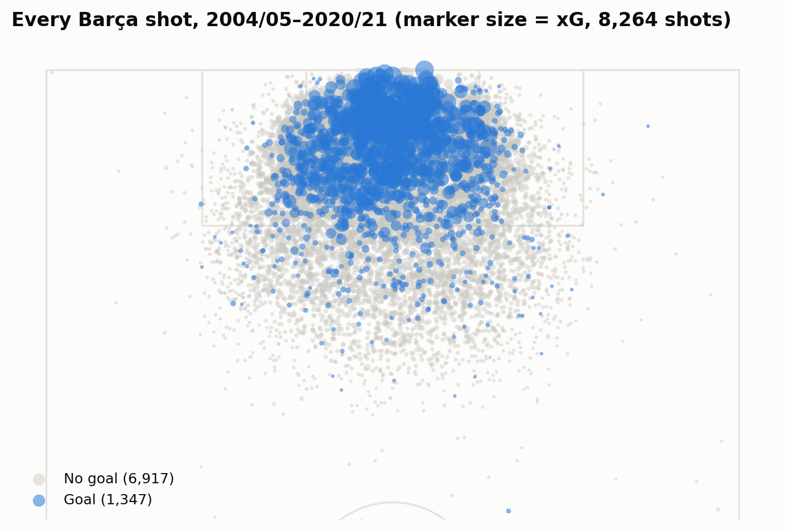
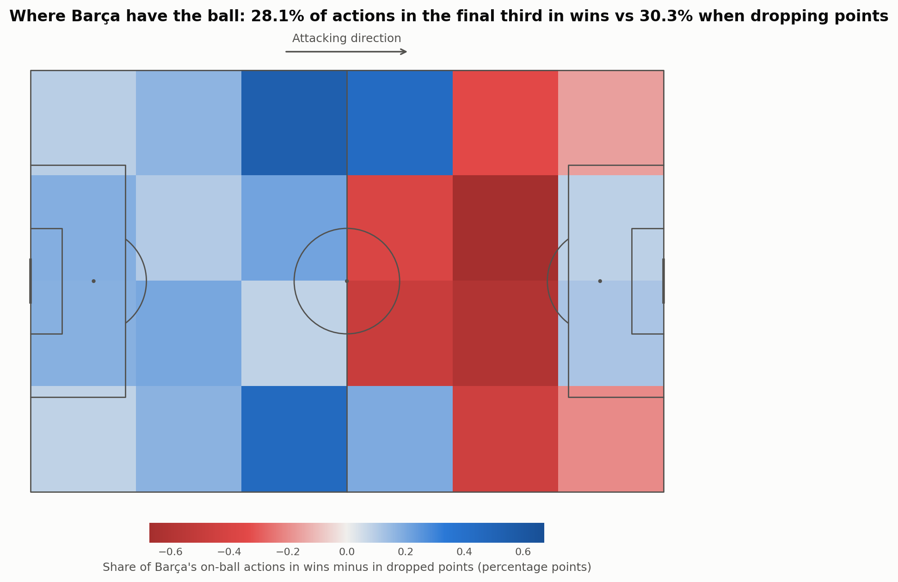
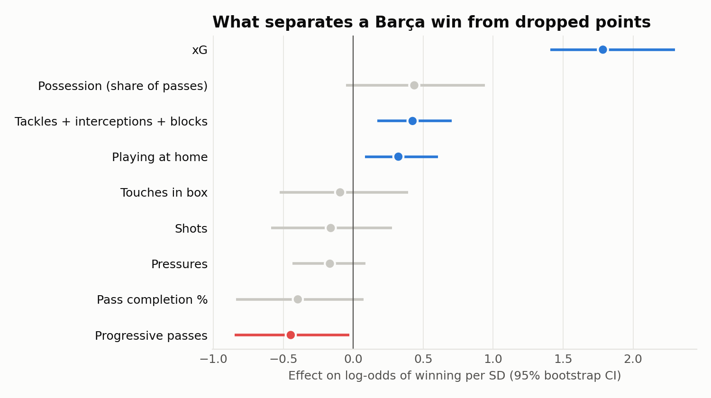

# What Wins Barça Games? FC Barcelona Match Analysis, 2004/05–2020/21

**▶ [Explore the interactive site](https://smyans.github.io/fc-barcelona-stats/)**
**▶ [Barça now: next-match forecast & live win predictor](https://smyans.github.io/fc-barcelona-stats/now.html)**

An event-data analysis of 524 FC Barcelona La Liga matches across the Messi era. It asks one question:
**when Barça win, and when they drop points, what's actually different?** It has three parts:

1. **Player stats vs. results:** 26 per-90 metrics for every Barça player performance, by position group, with multiple-comparison correction.
2. **Pitch views:** every shot for and against, and where Barça have the ball in wins vs dropped points.
3. **A win model:** a logistic regression that separates wins from dropped points using in-game stat differences, tested on seasons it never saw.



## Key findings

- **It comes down to chances, not the ball.** In wins, Barça created a median 2.14 xG and allowed 0.66. When they dropped points,
  it was 1.24 and 1.08. Possession barely changed: 66.5% of the passes in wins, 67.6% when dropping points.
- **Dropped points happen around the opponent's box.** When Barça drew or lost, they had *more* of their on-ball actions in the opponent's half
  (59.1% vs 56.6%), concentrated just outside the penalty area. That's the signature of a team failing to break down a deep defence.
- **The forwards defended.** For Barça's attackers, pressing, tackling and winning the ball back in midfield all go with winning,
  alongside the obvious xG, xA and shots.
- **Midfield: keep it clean and switch it.** Midfield pass completion and switches of play go with winning. Progressive carries go with
  dropped points, usually a sign the passing lanes were closed.
- **Better finishing than the chances deserved, every season.** 1,347 goals from 1,053 xG, ahead of xG in all 17 seasons.
  Messi: 472 goals from 324 xG (+148).
- **The model separates wins from dropped points with ROC AUC 0.84** on held-out seasons (0.81 from xG difference alone), and its
  probabilities are well calibrated: at 95%+, Barça won 97% of the time.

| Barça's shots | Where Barça have the ball |
|---|---|
|  |  |



## Barça now (2023/24 to today)

A second page brings the project up to date with every La Liga match since 2005/06 from
[football-data.co.uk](https://www.football-data.co.uk/): results, shots, corners, fouls, cards and closing bookmaker odds.

- **What's been driving results:** the target is points *above what the odds expected*, so opponent strength is already accounted for.
  Barça have beaten expectations in every season since 2023/24 (+29 points over 124 games). The unlikely link: with 12+ fouls committed,
  Barça beat the odds by +0.38 points a game; with 7 or fewer, they fell 0.19 short. Across La Liga, teams that win 9+ corners fall 0.37 points
  short of expectations, a sign of a team stuck against a deep defence.
- **Pre-match model:** Poisson regressions on Elo, recent form, scoring habits and rest, with a Dixon–Coles low-score correction.
  Tested season by season on 2023/24 onwards, it captures 86% of the bookmakers' edge over guessing (log loss 0.969 vs 0.954 for the market).
- **Live model:** a minute-by-minute simulation of the goal difference that starts from the pre-match expected goals and accounts for when goals
  tend to come, red cards (estimated from 1,650 matches) and teams chasing a game. Knowing the half-time score cuts prediction error in Barça games
  from 0.72 to 0.64. Barça games average about 20% more goals than ratings predict, so that's fitted on 2006–2021 minute-by-minute data and confirmed on 2023/24 onwards.

Refresh after each matchday:

```bash
python run_now.py
```

## Data

[StatsBomb Open Data](https://github.com/statsbomb/open-data) via [`statsbombpy`](https://github.com/statsbomb/statsbombpy):
~2 million events and full lineups for 524 La Liga matches. StatsBomb's free La Liga release covers the league games Lionel Messi
played for Barcelona, so this is the Messi era rather than every Barça match.

## Method

**Player analysis** ([`features.py`](barca_stats/features.py), [`analysis.py`](barca_stats/analysis.py))
- One row per Barça player per match (6,196 rows of 30+ minutes), with 26 metrics covering shooting, chance creation, passing,
  progression, ball retention and defending.
- Minutes are reconstructed from lineups, including stoppage time. Counts are converted to per-90 rates.
- Spearman correlation with the result (loss 0, draw 0.5, win 1) per position group, with Benjamini–Hochberg FDR correction.
- The heatmap's shade is −log₁₀ of the adjusted p-value, so darker means stronger evidence.

**Pitch views** ([`pitch.py`](barca_stats/pitch.py)): every non-shootout shot with StatsBomb xG. Barça's on-ball actions are binned into
20×20-yard zones and averaged over wins and over dropped points.

**Win model** ([`model.py`](barca_stats/model.py))
- One row per match: Barça-minus-opponent differences in xG, shots, touches in the box, share of passes, pass completion,
  progressive passes, pressures, and tackles + interceptions + blocks, plus a home/away flag.
- A standardised logistic regression predicts win vs dropped points (draw or loss).
- It's scored with **leave-one-season-out cross-validation** against always predicting the other seasons' win rate.
  Coefficient intervals come from a 1,000-sample bootstrap.

### Limitations

- Correlation, not causation. In-game stats are partly caused by the score: a team that's 2–0 up plays differently.
- Only matches Messi played are in the open data, so this isn't every Barça league game.
- Barça won 74% of these matches, so "dropped points" is the smaller group (138 matches).

## Run it yourself

```bash
python -m venv .venv && source .venv/bin/activate
pip install -r requirements.txt
python run.py
python -m http.server -d docs   # then open http://localhost:8000
```

The first run downloads and caches the data (~10 minutes, ~520 MB in `data/cache/`). `results/`, `figures/` and `docs/data/site.json`
are regenerated on each run.

## Project structure

```
barca_stats/
  data.py       # StatsBomb loading (Barça matches only, trimmed columns) with on-disk cache
  features.py   # event → player-match metrics, minutes played, per-90 conversion
  analysis.py   # Spearman correlations + FDR correction
  pitch.py      # shots for/against, zone-by-zone touch shares
  model.py      # team-match table, logistic regression, season-held-out CV, bootstrap
  plots.py      # static charts (matplotlib + mplsoccer)
  export.py     # JSON for the interactive site
  fd.py         # football-data.co.uk results, stats and odds (2005/06 to now)
  ratings.py    # Elo, recent form, scoring habits, rest
  prematch.py   # Poisson pre-match model, Dixon-Coles, walk-forward backtest
  inplay.py     # live win-probability model and its validation
  recent.py     # stats behind beating or missing expectations (2023/24 on)
  export_now.py # JSON for the Barça now page
run.py          # Messi-era pipeline
run_now.py      # Barça now pipeline (re-run after each matchday)
docs/           # the interactive site (plain HTML/CSS/JS + SVG, served by GitHub Pages)
```

## See also

[What wins World Cup matches?](https://github.com/smyans/world-cup-2022-player-stats), the same approach applied to the 2022 FIFA World Cup.

## Acknowledgements

Data provided by [StatsBomb](https://statsbomb.com/) through their free Open Data release.
